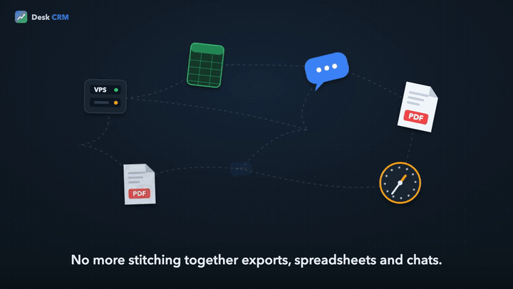

# Explainer video skill

A Claude Code skill and a small toolchain that turns one HTML file into an MP4 product explainer, with original synthesized music and synced sound effects.



The gif is silent. [assets/demo.mp4](assets/demo.mp4) is 20 seconds of the same video with its synthesized music and sound effects.

You describe a product. Claude writes a storyboard, then one HTML file where every frame is a function of time. A Node script steps through that function and pipes the frames into ffmpeg. A Python script writes a music bed and sound effects that land on the same beats as the animation. The output is a 1080p MP4, a poster frame and a contact sheet.

You can use it two ways: as a Claude Code skill, where you ask for a video in plain words, or as plain scripts, where you edit the HTML yourself.

## Why

- **One look.** Every video shares the same stage, palette, type scale, cursor and motion language. `SKILL.md` writes all of it down, so the tenth video looks like the first.
- **Deterministic frames.** `renderAt(t)` rebuilds the frame from `t` alone. No timers, no `Math.random`, no screen recording. The same file renders the same video every time, and you can grab any frame as a still to check it.
- **No licensed assets.** The music and every sound effect are synthesized in numpy. No samples, no stock tracks, no fonts to ship. What you render is yours to publish.

## Requirements

- Node 18 or newer
- ffmpeg, with ffprobe
- Python 3 with numpy (`requirements.txt`)
- macOS `say`, optional, only for the voiceover

It was built and tested on macOS. The stage font is Avenir Next; on other systems it falls back to Helvetica Neue or Arial, and the layout still measures its text with the font it actually gets.

## Quick start, standalone

```bash
git clone https://github.com/pedro-cmyks/explainer-video-skill.git
cd explainer-video-skill
npm install
npx playwright install chromium
```

Then install numpy for the audio script. If your `python3` comes from Homebrew, which it does on most Macs that installed ffmpeg with Homebrew, use Homebrew:

```bash
brew install numpy
```

With any other Python, use pip: `python3 -m pip install -r requirements.txt`. If pip refuses with `error: externally-managed-environment`, that Python is managed by Homebrew or by your system, so run `brew install numpy` instead. A virtual environment also works, but you have to keep it activated whenever you run `compose.py` or the npm scripts, so prefer `brew install numpy` if you will use the repo as a skill:

```bash
python3 -m venv .venv && source .venv/bin/activate && python3 -m pip install -r requirements.txt
```

Render the example, a 20 second teaser for a fictional task app:

```bash
node templates/render.mjs --html examples/tidy-tasks/explainer.html --out examples/tidy-tasks/tidy-tasks.mp4
```

That writes `tidy-tasks.mp4`, `tidy-tasks-poster.png` and `tidy-tasks-contact.png`. It takes about two minutes. Then compose the music and mux it:

```bash
python3 examples/tidy-tasks/compose.py --html examples/tidy-tasks/explainer.html --video examples/tidy-tasks/tidy-tasks.mp4
```

That writes `tidy-tasks-music.mp4` and the stems in `examples/tidy-tasks/audio/`. The same two steps are `npm run example:render` and `npm run example:compose`.

To start your own video, copy the template and the audio script into a work folder and render from there:

```bash
mkdir my-video && cp templates/explainer-template.html my-video/explainer.html && cp templates/compose.py my-video/
open my-video/explainer.html                       # it loops in the browser while you edit
node templates/render.mjs --html my-video/explainer.html --stills 3.2,4.9 --stills-dir my-video/critique/v1
node templates/render.mjs --html my-video/explainer.html --out my-video/my-video.mp4
python3 my-video/compose.py --html my-video/explainer.html --video my-video/my-video.mp4
```

`node templates/render.mjs --help` lists every option.

## Quick start, as a Claude Code skill

Put the repo where Claude Code looks for skills, under the name `explainer-video`:

```bash
git clone https://github.com/pedro-cmyks/explainer-video-skill.git ~/.claude/skills/explainer-video
cd ~/.claude/skills/explainer-video
npm install
npx playwright install chromium
brew install numpy
```

`brew install numpy` is for Homebrew Python. With any other Python, run `python3 -m pip install -r requirements.txt` instead. Claude runs `python3 compose.py` from your work folder, so numpy has to be importable by the `python3` on your PATH, not only inside a virtual environment in the repo.

If you already cloned it somewhere else, a symlink works too: `ln -s "$(pwd)" ~/.claude/skills/explainer-video`.

Then open Claude Code in any folder and ask for a video. For example: "Make a 30 second explainer for my invoicing app. Three features: import a bank file, match payments, send reminders." Claude follows `SKILL.md`: brief, storyboard, build, stills, render, critique against `checklist.md`, audio. You get the MP4, the poster and the contact sheet in your folder.

## How a video is structured

One self contained HTML file. A 1920x1080 SVG stage and one script.

The script lists the scenes back to back:

```js
const SCENES = [
  { id: 'title', start: 0, dur: 5, fn: sTitle, cap: null },
  { id: 'cards', start: 5, dur: 12, fn: sCards, cap: ['Every source syncs in one click.'] },
  { id: 'outro', start: 17, dur: 7, fn: sOutro, cap: null },
];
```

- **Scenes.** A scene is a function of its local time, `fn(lt, dur)`, that returns SVG and, optionally, a cursor with key positions and click times. Every beat inside a scene is a local constant, such as `const click = 3.2`.
- **renderAt.** `window.renderAt(t)` finds the scenes at `t`, cross fades between them, draws the caption, the brand mark and the cursor last. It is pure. `render.mjs` opens the page with `#manual`, calls it once per frame at 30 fps and pipes PNG frames to x264.
- **Captions.** One or two short lines at the bottom, 50 px, sentence case, ending with a period. They fade in after the scene starts and out before it ends. The copy rules in `SKILL.md` set the minimum time on screen per word.

The template ships the helper kit: easing, cards, chips, status dots, packets that fly between cards, charts that draw themselves, checkboxes, a progress ring and the cartoon cursor that glides, squashes and bursts on click. `reference/desk-crm-explainer.html` is a full 84.5 second video of a CRM shown with sample data only, and `reference/contact.png` is its frame grid. Most new scenes start by copying a pattern from it.

## Themes

One motion language, many looks. A theme is a small json in `themes/` with the palette tokens, the gradients, the font, the card radius, the logo mark and the music settings (key, chord order, tempo, arpeggio). The motion, the cursor, the captions and the checklist never change. Same theme, same scenes: the same video, frame for frame. Change the theme and the same scenes come out in another palette, another mark and another key.

```bash
node templates/apply-theme.mjs --list
node templates/apply-theme.mjs --theme studio --html explainer.html
```

| Theme | Stage | Action colour | Logo mark | Font | Music |
| --- | --- | --- | --- | --- | --- |
| `house` | navy | blue | check | Avenir Next | D major, I V vi IV, 104 BPM |
| `studio` | violet | violet | ring | Futura | A major, vi IV I V, 125 BPM |
| `ember` | charcoal | orange | bolt | Georgia | F major, IV I V vi, 96 BPM |

To make one, copy a json, change the values, keep `gr`, `am` and `rd` readable as green, amber and red (they carry meaning), use a font that exists on the machine that renders, and read the contact sheet for contrast. `compose.py` reads the music settings from the `THEME` block in the HTML, so the HTML is the single source of truth for a video.

A video can also change theme as it plays: add more theme objects to `THEMES` in the HTML and give scenes a `theme` key. The palette morphs across the cross fade between scenes, the font and the mark switch on the boundary, and the music keeps the first theme's key.

## The audio pipeline

`compose.py` reads `TOTAL`, `SCENES` and the outro stats straight from the HTML. Sound effects are written as offsets local to each scene, with the same numbers as the scene code, so moving a scene moves its sounds.

- **Music.** D major, I V vi IV, about 104 BPM. The tempo is adjusted so a whole number of bars fits between the start of scene 2 and the outro, and both land on a downbeat. Pad, plucked arpeggio, bass, kick with sidechain pump, hats, claps and a bell lead build from a sparse intro to full energy, with a riser and an impact on the drop and on the final logo.
- **Effects.** Click, pop, tick, chime, confirm, alert, whoosh and a few more, all synthesized. Every click gets a click, every arrival a chime, every scene change a whoosh centred on the cross fade. Pan follows the cursor.
- **Mastering.** The music is normalised to -18 LUFS, the effects sit on top with a shared reverb, and a 4x oversampled true peak limiter holds the mix under -1.5 dBTP. It writes the mix, the two stems and an `events.json` with every effect time, then muxes AAC into a copy of the video.

`SKILL.md` also has the house mix (effects forward, music ducked under them, -16 LUFS) as two ffmpeg commands on the stems.

## A note on voices

`templates/voiceover.sh` adds an optional narration with macOS `say`, ducked under the music, with any voice installed on your Mac. "Ava (Premium)" is a good one. Apple licenses these voices for personal, non commercial use. Use them for drafts and internal reviews. A video you publish should ship with the synthesized music only, or with a voice you have the rights to.

```bash
templates/voiceover.sh --video my-video/my-video.mp4 --lines my-video/lines.tsv --voice "Ava (Premium)" --rate 180
```

`lines.tsv` has one line per scene: `id<TAB>scene start<TAB>scene end<TAB>text`. The script ducks the music under the voice, warns when a line runs past its scene, and writes `my-video-voice.mp4` next to the video.

## Repository layout

```
SKILL.md                  the skill: look, motion language, copy rules, workflow, pipelines
checklist.md              critique checklist, every item must pass before delivery
templates/
  explainer-template.html start here: helper kit plus title, cards and outro scenes
  render.mjs              HTML to MP4, poster, contact sheet and stills
  compose.py              music bed and synced effects, mastered and muxed
  voiceover.sh            optional macOS voiceover
  apply-theme.mjs         stamps a theme from themes/ into a video's HTML
themes/                   house, studio, ember: palette, font, mark and music per theme
reference/
  desk-crm-explainer.html full reference video, fictional data
  contact.png             its contact sheet
examples/tidy-tasks/      a 20 second teaser built from the template
assets/                   the demo gif, a 20 second clip with sound, a poster frame
```

## Contributing

Issues and pull requests are welcome. The point is to build on it together.

Good places to start: new scene patterns, a vertical 1080x1920 layout, testing the render on Linux and Windows, more sound effects, or a narration option with a voice that can be published. If you make a video with it, open an issue and show it. Real videos are how the rules in `SKILL.md` got written.

## How it was built

Designed by Pedro Villegas and built with Claude Code. It was iterated on real videos: each rule in `SKILL.md` and each box in `checklist.md` comes from something that looked wrong in a render and got fixed.

## License

MIT. See [LICENSE](LICENSE).
