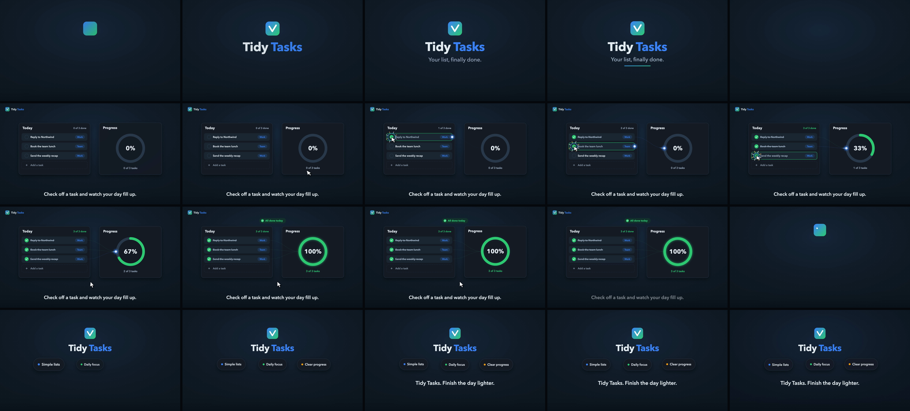

# Tidy Tasks

A 20 second teaser for a fictional task list app, made as the first test of the skill. Claude Code got a one paragraph brief, started from `templates/explainer-template.html`, replaced the example cards scene with a checklist scene (`checkbox`, `strike`, `packet` and `progressRing` from the template kit), used word pills in the outro because a fictional product has no true numbers, and added a `tasks` block to its copy of `compose.py` with the same beat times as the scene code.



Render it from the repo root:

```bash
npm run example:render     # examples/tidy-tasks/tidy-tasks.mp4, plus poster and contact sheet
npm run example:compose    # examples/tidy-tasks/tidy-tasks-music.mp4, stems in examples/tidy-tasks/audio/
```
